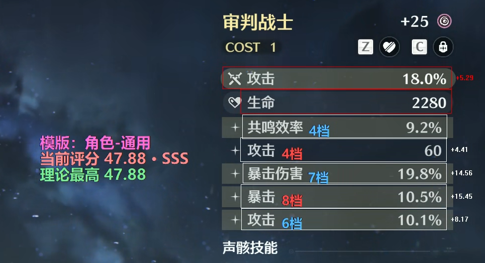
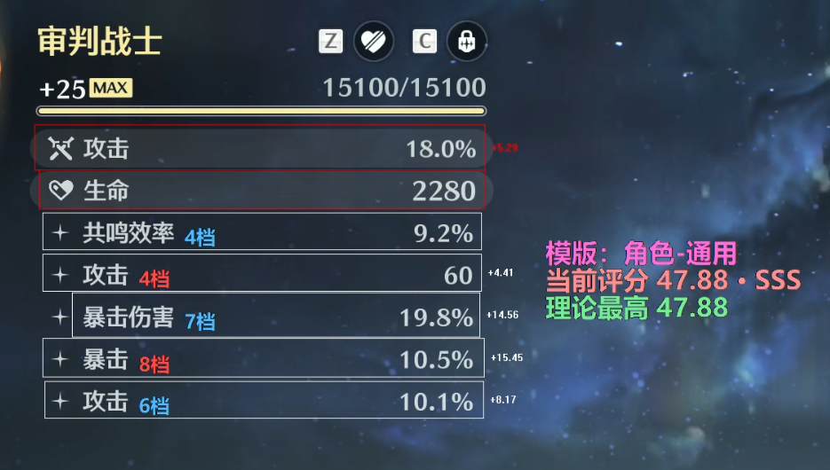
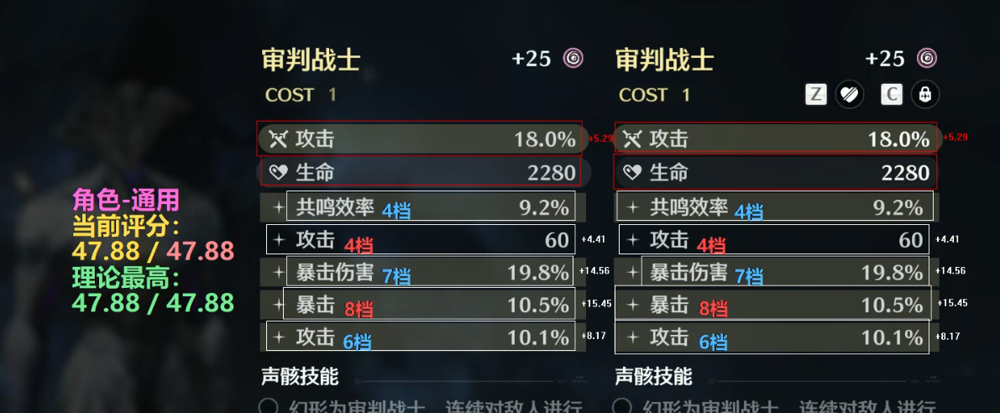
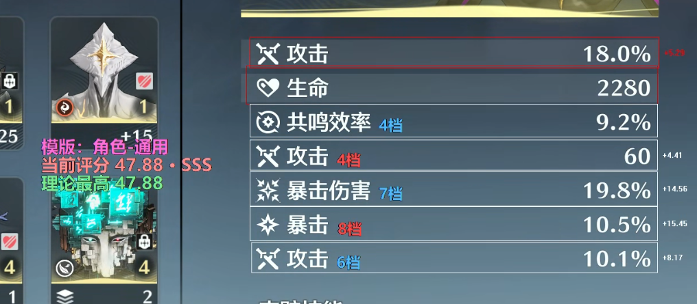
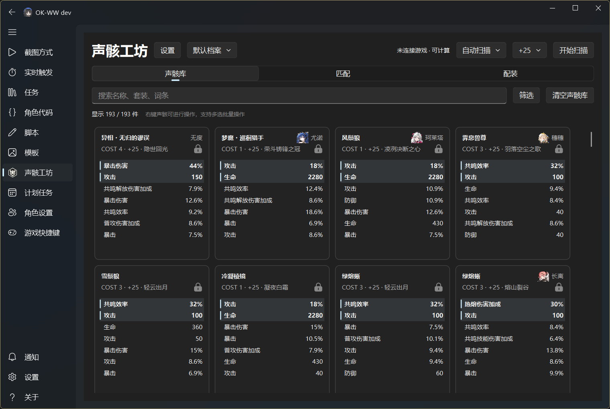
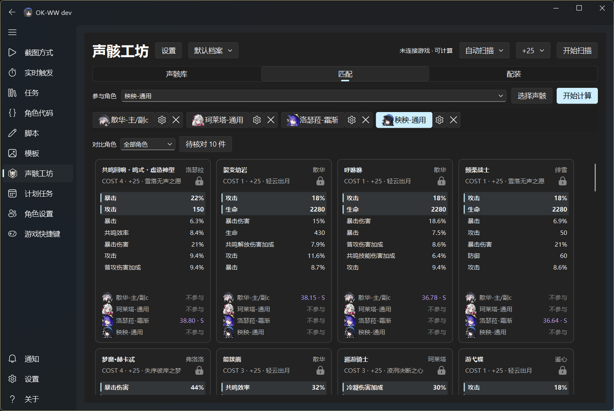
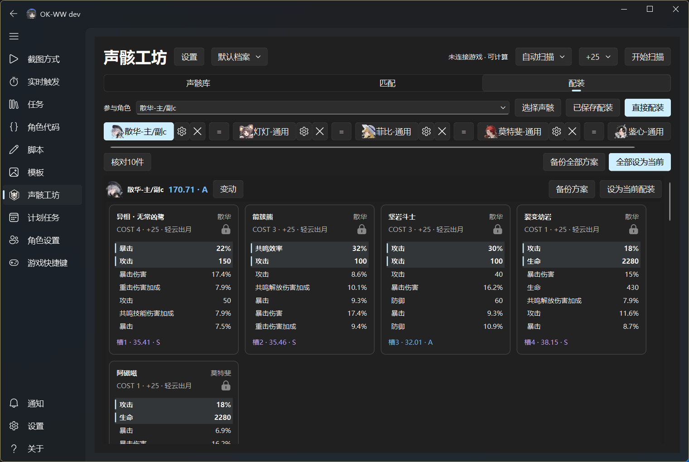
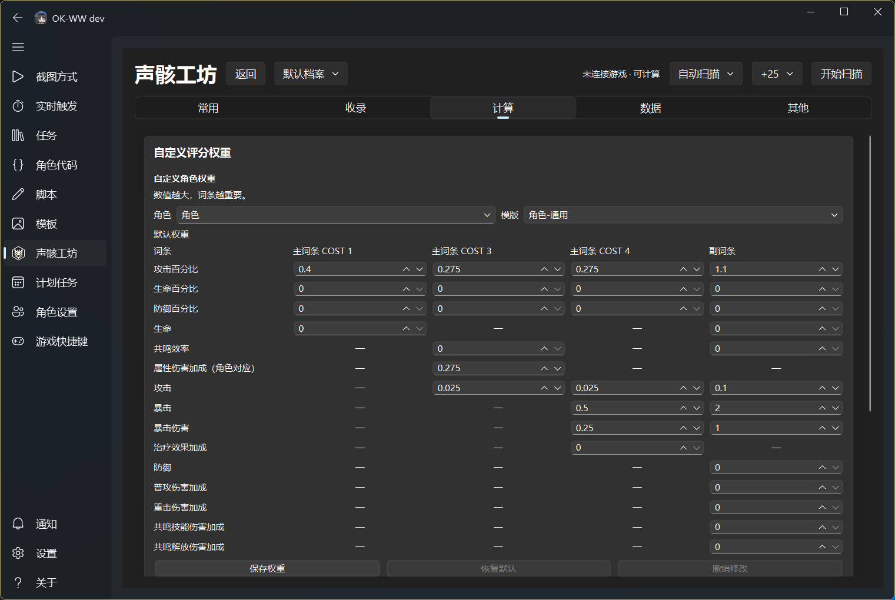

<div align="center">


# 声骸工坊

**Echo Workshop · 鸣潮实时评分、声骸收录与配装**


[](LICENSE)

</div>

## 简介

声骸工坊是 [OKWW](https://github.com/ok-oldking/ok-wuthering-waves) 的声骸工具插件，核心能力是**游戏内实时评分**：在背包、单件展示、左右对比、强化页面直接叠加当前评分、理论最高分与逐词条贡献。

在此基础上，插件提供更多功能：**声骸库、批量匹配和五件配装**。评分是 [XWUID](https://github.com/Loping151/XutheringWavesUID) 权重下的参考指标，不是游戏官方评级，也不等于伤害模拟。

<a id="live-score"></a>

## 实时评分

实时评分不写入库存，只读取当前画面并绘制浮层，适合边看声骸边比较。

<table>
  <tr>
    <td align="center" width="50%">
      <strong>单件词条</strong><br>
      <sub>词条框、档位、当前分与理论最高分</sub><br><br>
      
    </td>
    <td align="center" width="50%">
      <strong>展示页</strong><br>
      <sub>完整展示页右侧详情，浮层放在词条左侧</sub><br><br>
      
    </td>
  </tr>
  <tr>
    <td align="center" width="50%">
      <strong>左右对比</strong><br>
      <sub>左右两件独立解析，不使用左侧角色设置套右侧</sub><br><br>
      
    </td>
    <td align="center" width="50%">
      <strong>背包页</strong><br>
      <sub>右侧详情词条框选与逐词条贡献</sub><br><br>
      
    </td>
  </tr>
</table>

<a id="features"></a>

## 更多功能

- **收录**：手动收录当前声骸或扫描背包；识别存疑时先核对再入库，保留原始截图证据。
- **库存**：搜索、主词条/套装/COST 筛选、待核对、保护与档案管理。
- **匹配**：多角色对比同一批声骸，查看单件分数、评级与适配原因。
- **配装**：按角色要求、固定件、套装与优先级生成五件，跨角色不重复占用；支持保存、备份、历史与单槽替换。
- **计算**：评分、匹配与配装搜索由随包 Rust 引擎在后台执行；界面与计算分离，大库存批量计算不阻塞操作。

<a id="workflows"></a>

## 声骸计算

实时评分负责“眼前这一件”，声骸库负责“长期库存”，匹配负责“多个角色怎么看同一件”，配装负责“整套五件怎么选”。

<table>
  <tr>
    <td align="center" width="50%">
      <strong>声骸库与收录</strong><br>
      <sub>搜索、筛选、待核对、保护与档案</sub><br><br>
      
    </td>
    <td align="center" width="50%">
      <strong>多角色匹配</strong><br>
      <sub>单件当前分、理论最高分、评级与适配</sub><br><br>
      
    </td>
  </tr>
  <tr>
    <td align="center" width="50%">
      <strong>五件配装</strong><br>
      <sub>五槽 COST、套装、固定件、独占与优先级</sub><br><br>
      
    </td>
    <td align="center" width="50%">
      <strong>自定义评分权重</strong><br>
      <sub>主副词条权重与冻结历史</sub><br><br>
      
    </td>
  </tr>
</table>

<a id="install"></a>

## 如何安装

**Echo Workshop 是 [OKWW](https://github.com/ok-oldking/ok-wuthering-waves) 的插件，不能脱离 OKWW 单独运行，请先下载安装好 [OKWW](https://github.com/ok-oldking/ok-wuthering-waves/releases)。**

1. 首先，点击下载本项目的 [echo-workshop-版本号.zip](https://github.com/hxwd94666/Echo-Workshop/releases)。

2. 解压发行包，把 echo-workshop 文件夹放入 OKWW 的 ok_import 目录：
   ```text
   data/apps/ok-ww/working/ok_import/echo-score
   ```

   例如：
   ```text
   D:\ok-ww\data\apps\ok-ww\working\ok_import\echo-score
   ```
3. 启动 OKWW，选择开始运行，然后打开左侧 **声骸工坊**。

安装后的目录结构：

    OKWW 运行目录/
    └─ ok_import/echo-workshop/

**数据位置**：玩家数据在宿主配置目录的 plugin_data/echo-workshop 下，不在插件安装文件夹。替换或重装插件不会覆盖库存与配装。

## Windows 安全提示

插件包含未签名的本地 Rust 计算程序（native/bin/echo-workshop-compute.exe），Windows 或 Defender 可能提示“打开这些文件可能会对你的计算机有害”或“Windows 已保护你的电脑”。它只在本机计算，不下载或执行远程代码。

- 右键 ZIP → **属性** → 勾选 **解除锁定** → 确定；
- 或解压后在 PowerShell 对 ok_import/echo-workshop 目录执行 Unblock-File；
- 若 Defender 实际隔离了该 exe，确认来源后把 ok_import/echo-workshop 加入排除项，不要关闭 Defender。

<a id="quick-start"></a>

## 参与开发

源码要求 **Python 3.11+**。界面验收组合为 Python 3.12、ok-script 2.0.8、PySide6 6.11.1、Fluent Widgets 1.11.3。Rust 计算引擎使用锁定的 1.98.0 工具链，插件用户无需安装 Rust。

    py -3.12 -m venv .venv
    .venv/Scripts/python.exe -m pip install -e ".[ui,okww,dev]"

    .venv/Scripts/python.exe -m ruff check src plugin tests tools
    .venv/Scripts/python.exe -m ruff format --check src plugin tests tools
    .venv/Scripts/python.exe -B tools/check_structure.py
    .venv/Scripts/python.exe -B tools/run_checks.py --calculation
    .venv/Scripts/python.exe -B tools/run_checks.py --smoke
    .venv/Scripts/python.exe -B tools/compute.py build
    .venv/Scripts/python.exe -B build.py

| 目录 | 职责 |
| --- | --- |
| src/echo_workshop/native/compute/ | Rust 计算引擎 |
| src/echo_workshop/application/ | 用例、异步作业、运行时组合 |
| src/echo_workshop/storage/、resources/、capture/ | 本地数据、资料更新、收录识别 |
| src/echo_workshop/ui/ | 声骸库、匹配、配装、设置界面 |
| plugin/okww/ | 三个薄宿主入口与 manifest |
| tests/calculation/、tests/contracts/ | 计算验证、强路径契约 |

版本唯一来源是 src/echo_workshop/__init__.py；不要编辑 dist/ 中的生成代码。更多细节见[维护文档](docs/README.md)与[贡献指南](CONTRIBUTING.md)。

## 致谢

声骸工坊不是从零长出来的，感谢以下项目和数据维护者的开发和支持。

- [ook-wuthering-waves](https://github.com/ok-oldking/ok-wuthering-waves): 提供宿主运行环境。

- [XutheringWavesUID](https://github.com/Loping151/XutheringWavesUID) 及其 [资源目录](https://cnb.cool/loping151/XutheringWavesUID-Resources): 提供评分与资料基础。

- [okww-xwuid-echo-score](https://github.com/IceHe/okww-xwuid-echo-score): 提供最初的插件评分/OCR 实现和项目起点。

- [Nanoka](https://ww.nanoka.cc/) 与 [Encore](https://encore.moe/?lang=zh-Hans): 提供游戏基础目录和资源来源.

## 许可与来源

项目遵循 [GPLv3](LICENSE)。第三方来源、许可与再分发边界见 [THIRD_PARTY_NOTICES.md](THIRD_PARTY_NOTICES.md)。游戏图像属于其权利人，本项目不是游戏官方产品。
